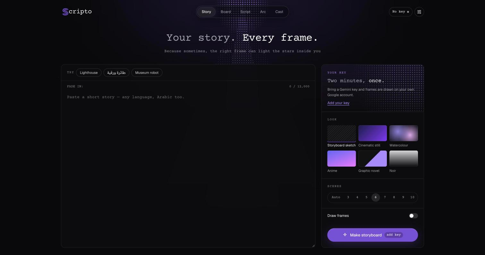
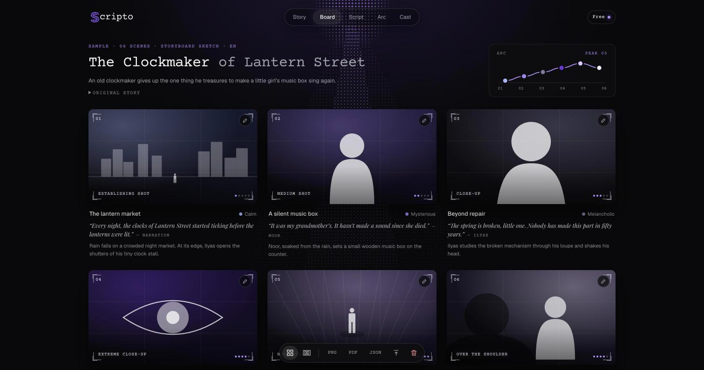
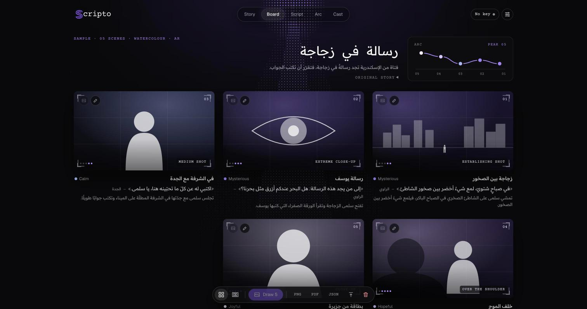

# Scripto

**Your story. Every frame.** Paste a short story and Scripto splits it into scenes, each with a camera shot, a mood, the characters and setting, a screenplay heading and a line of dialogue or narration. Then it draws a frame for every scene in one consistent look.

**Live:** https://moviconexus.me/scripto/
(open a sample directly: [English](https://moviconexus.me/scripto/?demo=clockmaker) · [Arabic, right to left](https://moviconexus.me/scripto/?demo=bottle) · [Noir](https://moviconexus.me/scripto/?demo=lighthouse))

Scripto runs in two places from one codebase: as a static site where visitors bring their own Gemini key, and on [Zibby](https://zibby.run), where visitors pay per run in credits and need no key at all.



## Five tabs

| Tab | What it shows |
| --- | --- |
| **Story** | The story box, with one-click **Try** stories (one in Arabic), the look (six styles), the number of scenes, and the samples gallery "Made with Scripto". |
| **Board** | Every scene as a 16:9 frame in viewfinder corners, with its number, shot, intensity, mood and spoken line. Switch between a grid and a horizontal **film strip** with sprocket holes and edge print. A floating dock draws frames and exports PNG, PDF and JSON. |
| **Script** | The same storyboard read as a screenplay: `EXT. LANTERN MARKET — NIGHT`, the action, then the line under its speaker. |
| **Arc** | The emotional arc as one violet line across the scenes, the mood of each scene, and the same data as a table. |
| **Cast** | Every recurring character, how they are drawn in every frame, and the scenes they appear in. |



Stories in Arabic, Hebrew, Persian or Urdu keep their language, and the board, the arc and the script all switch to right to left.



## Two ways to run it

|  | Own key (GitHub Pages) | On Zibby |
| --- | --- | --- |
| Who pays the models | The visitor's own Google account | The visitor's Zibby credits (new accounts get 200 free) |
| Scenes | Gemini `gemini-3.8-flash` | Claude Sonnet 5, through Zibby |
| Frames | Gemini `gemini-3.1-flash-image` (paid tier) | Gemini 3.1 Flash Image, through Zibby |
| Key | Pasted in Settings, kept in the browser | None |
| Network | The site and Google's API only | The page's own origin only |

The build flag `VITE_SCRIPTO_HOST=zibby` picks the host. A Vite alias (`@host`) swaps in one of two small modules, `src/host/byok.ts` or `src/host/zibby.ts`, so the own-key bundle carries no Zibby code at all.

### Getting a Gemini key (own-key site)

1. Open [aistudio.google.com/apikey](https://aistudio.google.com/apikey) and sign in with Google.
2. **Create API key**, then pick or make a project.
3. Set up billing on that project if you want frames. The free tier writes scenes only; a frame costs about US$0.07 at 1K.
4. Optional but wise: limit the key to the Gemini API and add a small budget alert.
5. Paste it into Scripto's **Settings**. It stays in your browser.

## How it works

```
story ──► text model ──────────────► JSON ──► validate + repair ──► storyboard
          (JSON Schema structured                                        │
           output, low thinking)                                         ▼
                                              for each scene: image prompt
                                              (style + shot + mood + cast)
                                                                         │
          image model ◄──────────────────────────────────────────────────┘
          (16:9 frame, optional style reference)
                │
                ▼
          data: URL frame  ──or on failure──►  SVG sketch frame
```

On the own-key site both calls go to the Gemini **Interactions API** with `store: false`, the key in the `x-goog-api-key` header.

On Zibby both calls go to the platform's same-origin `POST /api/ai` proxy through [`@zibby-run/app-kit`](https://www.npmjs.com/package/@zibby-run/app-kit). Scenes are an Anthropic Messages request with `output_config.format` set to the same JSON Schema, minus the keywords Claude does not take; those limits are still checked when the answer arrives. Frames are an OpenAI-format request with `modalities: ["image", "text"]`. Scripto follows the platform's rules:

- The only charge it shows is the one in the proxy's final event.
- A run without one shows "charge unknown" and its request id.
- It never retries a paid call by itself.
- It asks before resending past the spending cap.
- It offers a top-up when credits run out.

| Module | Role |
| --- | --- |
| `src/lib/backend.ts` | The backend interface, and the Gemini backend |
| `src/lib/zibby.ts`, `src/lib/zibbyPayloads.ts` | The Zibby backend, its refusals in plain words, and the pure request builders (also used for `zibby-sample.json`) |
| `src/host/` | Everything that differs per host: header pill, quotes, top-up and sign-in, start-up |
| `src/lib/prompts.ts`, `src/lib/schema.ts` | System instruction, story input, JSON Schema and image prompts |
| `src/lib/gemini.ts`, `src/lib/errors.ts` | Gemini client, timeouts, one retry on 5xx, plain-language errors |
| `src/lib/validate.ts` | Parses and repairs the model's JSON, including scene headings |
| `src/lib/generate.ts` | Story → storyboard, then frames (style reference, limited concurrency, stops on fatal errors) |
| `src/lib/placeholder.ts`, `src/lib/exportImage.ts` | Sketch frames, PNG export |
| `src/lib/persist.ts` | Keeps the board in this browser: text in localStorage, frames in IndexedDB |
| `src/components/` | The five tabs, the dock, the film strip, the arc, the settings drawer |

## Quick start

Requires Node.js 22.12 or newer.

```sh
npm ci
npm run dev          # own-key site at http://localhost:5173/scripto/
npm run dev:zibby    # Zibby version with the kit's mock: no network, no credits
npm run check        # lint, typecheck, tests, and both builds
```

## Configuration

Everything is set in the **Settings** drawer and saved in `localStorage`.

| Setting | Own key | Zibby |
| --- | --- | --- |
| Draw frames after the scenes | off (frames need a paid key) | on |
| Match every frame to the first | on | on |
| Scenes model | `gemini-3.8-flash`, any Gemini id | Claude Sonnet 5, Haiku 4.5 or Opus 5 |
| Thinking | low | low (effort; not for Haiku 4.5) |
| Frames model | `gemini-3.1-flash-image` | Gemini 3.1 or 2.5 Flash Image |

Build-time values: `VITE_SCRIPTO_HOST=zibby` for the Zibby build, and optionally `VITE_ZIBBY_URL=https://zibby.run/@owner/app` to point the own-key site's first-try card at Scripto on Zibby.

## Privacy

- **Own key:** the key lives only in this browser's localStorage and is sent only to `generativelanguage.googleapis.com`. Google receives the story and the frame prompts, with `store: false`.
- **Zibby:** Scripto holds no key and no secret. The visitor signs in to Zibby; Scripto's page talks only to its own origin, and Zibby forwards the requests to the model providers.
- Both builds ship a strict Content-Security-Policy, bundle their own fonts, and have no analytics, cookies or third-party scripts.

## Deploying

**GitHub Pages:** `.github/workflows/deploy.yml` builds and publishes `dist/` on every push to `main`.

**Zibby:** publishing from a repository is by invitation. Connect the repository through Zibby's GitHub App (only this repository, read-only) and pick the branch. Zibby detects Vite: `npm ci`, `npm run build`, output `dist`. It also reads `zibby.json` at the root, which sets `VITE_SCRIPTO_HOST=zibby` for the build. The build needs no network and writes `dist/zibby-sample.json`, the requests Zibby replays to price the app.

## Design

Black ground, one violet light, a halftone projector beam behind every page. Courier Prime is the screenplay voice for titles, headings and numbers. Geist is the interface, and Playfair Display italic is used only for spoken lines. The logo is the S of Scripto drawn as a strip of film. Moods stay inside the violet family. All fonts are bundled from Fontsource (SIL Open Font License); Arabic uses Readex Pro.

## Tests

```sh
npm test
```

230 tests in Vitest and Testing Library, with no real API calls. They cover:

- the request bodies for both hosts
- validation and repair, including scene headings
- the Gemini client and the Zibby error mapping
- charges, the cap-acknowledged retry and the credits refusal
- every tab, the film strip, settings, import, export and two-step clear
- right-to-left layout

## Limitations

- **Frames cost money.** On the own-key site they need a paid-tier Gemini key; on Zibby each frame is about 9 credits.
- **Consistency is approximate.** Shared character descriptions and a style reference help, but faces and props can drift between frames.
- **The model can get things wrong.** Scripto repairs what it can and lets you edit or redraw any scene.
- **Short stories only.** Up to 12,000 characters and 3–10 scenes.
- **English interface.** Stories and scenes can be in any language.

## License

[MIT](LICENSE) © 2026 Aya Nabil
